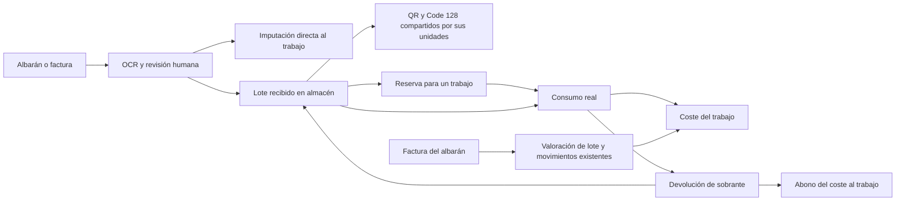

# Instala · arquitectura y primera fase

Aplicación para una empresa por instalación. Interfaz en español, Next.js App Router y TypeScript, Tailwind y componentes shadcn basados en Radix. PostgreSQL 16 y Prisma 6; importes NUMERIC y operaciones Decimal. Better Auth local con sesiones persistentes, sin registro público. Roles ADMIN y TECHNICIAN. Ningún dato comercial de ejemplo se instala.

## Pantallas y recorrido

Inicio: indicadores calculados, trabajos recientes, documentos que requieren revisión. Trabajos: listado filtrable, alta, expediente con materiales, horas, costes, presupuesto y ventas. Facturas: bandeja de documentos, cámara/galería/PDF, estado OCR, editor obligatorio de revisión, facturas de venta y cobros. Proveedores: datos fiscales y contacto, compras vinculadas. Beneficios: resultados netos por trabajo y servicio, gráfico, exportación CSV. Configuración: empresa, clientes, trabajadores y costes por hora. Botón Añadir en móvil con accesos a los seis registros principales.

El técnico accede únicamente a trabajos asignados, documentos propios de esos trabajos y registro de horas/material. No recibe ventas, costes horarios ni beneficios en las respuestas del servidor.

## Flujo documental y contable

Subida validada → archivo privado con nombre UUID → cola Document en PostgreSQL → worker con arrendamiento y reintentos → texto OCR no contabilizado → revisión humana de cabecera y líneas → asignación de cantidades por trabajo → confirmación atómica y auditoría. Una línea puede repartirse entre varios trabajos duplicando la referencia y repartiendo la cantidad en el editor. La suma de líneas debe coincidir con la base declarada; ninguna propuesta se confirma automáticamente.

En la imputación directa, cada albarán confirmado genera costes provisionales. En el flujo de almacén, el albarán crea lotes y los costes se asignan al consumir material; la factura posterior valora esos mismos movimientos sin otra entrada ni otro coste. Al confirmar su factura se selecciona el albarán sustituido: se anulan sus costes en la misma transacción que crea los de la factura. En esta fase se admite una factura que sustituye un albarán completo; las conciliaciones parciales y de varios albaranes quedan para fase 2. Unicidad de archivo SHA-256 y de número/proveedor/tipo, confirmación única y transacciones Serializable impiden dobles imputaciones. Albaranes sin valoración permanecen pendientes hasta que el usuario introduzca costes o llegue la factura.

Ingresos = bases de facturas de venta. Cobros = pagos brutos registrados. Costes = materiales confirmados + horas × coste histórico + costes directos. Beneficio bruto = ingresos netos − costes directos; operativo estimado = bruto − gastos generales asignados. Margen = beneficio/ingresos; sin ventas se muestra sin margen. El precio objetivo usa coste/(1−margen), nunca coste×(1+margen). El IVA recuperable no es coste. Los impuestos no recuperables se introducen expresamente como coste adicional. Las facturas de venta se registran para control interno; la aplicación no constituye un sistema de emisión fiscal certificado.

## Estructura

`src/app`: páginas y API. `src/components`: interfaz y shadcn. `src/lib`: autorización, validación, cálculos, operaciones y Prisma. `prisma`: esquema y migración versionada. `worker`: OCR local. `scripts`: instalación, copias, restauración y usuarios. `tests`: cálculos, seguridad e integración. `docs`: manuales y alcance.

## Modelo de datos

Company → User, Customer, Supplier, Worker, Job, Document, Sale, Quote, Overhead y Audit. User → Session y Account (Better Auth). Job → Cost, TimeEntry, Sale, Quote y DocumentLine. Document → líneas y OCR/cola; puede sustituir un albarán. Cada Cost conserva origen y documento; TimeEntry congela el precio laboral de la fecha. Quote almacena entradas y resultado del cálculo. StockLot conserva origen, cantidad y valoración; StockMovement y StockReservation documentan uso y reservas. StockCount registra saldo esperado, contado, motivo y autor; sus movimientos COUNT_OUT/COUNT_IN ajustan existencias y revierten faltantes concretos sin costes ficticios de obra. SupplierConnection, CatalogProduct, SupplierReference, PriceHistory, MaintenanceContract, Equipment y SyncTask preparan fases posteriores, sin fingir conectores operativos.

## Operación

Docker Compose: web, worker, PostgreSQL y backup diario. Solo web se publica en 127.0.0.1; base de datos sin puerto externo. Volúmenes persistentes para datos, documentos y copias. OCR: Poppler para PDF, Sharp para orientación EXIF/contraste y Tesseract spa+eng. No hay IA externa ni APIs de pago. La corrección automática de perspectiva y extracción tabular especializada se reservan para iteraciones posteriores: el MVP proporciona texto y edición manual segura, sin inventar líneas.

PWA instalable con manifiesto y pantalla sin conexión. Los datos sensibles y las mutaciones requieren conexión con el servidor local; el service worker no almacena respuestas privadas. Acceso por red y cámara móvil requieren configurar origen y HTTPS (manual de instalación).

## Fases posteriores

Fase 2: stock/consumos/devoluciones, conciliación parcial, plantillas completas, IMAP/CSV/Excel y conectores autorizados verificables, comparación de productos equivalentes, contratos y fichas de equipos. Fase 3: análisis histórico con umbrales de evidencia, predicción y búsqueda natural opcional. Estos módulos no se presentan como terminados.

## Segunda iteración: navegación y almacén

El layout de trabajo mantiene montado el panel entre rutas de Next.js. El servidor entrega el estado inicial; SWR lo comparte en memoria y lo actualiza tras guardar y al recuperar el foco. Los enlaces precargan rutas y `next/dynamic` separa gráficas, almacén, revisión y lector de cámara. El OCR completo se recupera al abrir el documento. La búsqueda de contenido se ejecuta en el servidor con el ámbito de empresa del usuario.

Tablas nuevas: StockLot conserva identificador, recepción, cantidades, valoración y ubicación; StockMovement conserva entradas, salidas, devoluciones, reservas, usuario y fecha; StockReservation conserva el saldo reservado por lote/trabajo. Cost enlaza cada consumo o devolución mediante una clave única. Las cantidades y valores se calculan con Decimal, dentro de transacciones Serializable. Las restricciones de PostgreSQL impiden saldos negativos y movimientos no positivos.

No se convierten automáticamente las compras antiguas imputadas directamente a trabajos. La conciliación de almacén inicial cubre un albarán completo. Pedidos, recepciones parciales, transferencias, recuentos y catálogo maestro quedan planificados en `PLAN_DE_CONTINUACION.md`.

Referencias técnicas: [layouts persistentes de Next.js](https://nextjs.org/docs/app/getting-started/layouts-and-pages), [precarga de rutas](https://nextjs.org/docs/app/guides/prefetching) y [transacciones Prisma 6](https://www.prisma.io/docs/orm/v6/prisma-client/queries/transactions).

## Tercera iteración: reconocimiento y cierre trimestral

- `src/lib/supplier-match.ts`: NIF exacto y, si falta, similitud de nombre (normalización, palabras genéricas con poco peso, tolerancia a errores de OCR). Lo usa `parseOcr` y, a través de él, el worker.
- `src/lib/ocr.ts`: la propuesta añade `total`, `taxRate` y `supplierCandidates`. Sigue siendo una propuesta; la confirmación humana no cambia.
- `src/lib/quarters.ts` calcula el informe del trimestre (fechas UTC de documento): ventas por fecha de venta, compras por fecha de **factura de compra confirmada**, gastos generales con IVA y mano de obra a coste histórico. `src/lib/zip.ts` genera el ZIP en streaming sin cargar los archivos en memoria. `src/app/api/quarters/route.ts` expone JSON, CSV y ZIP solo al responsable.
- Interfaz: `src/components/quarters.tsx`, cargado de forma diferida desde el panel (`/trimestres`).
- Modelo: `Overhead.tax`. Las compras fiscales se leen de `Document` (PURCHASE confirmada), no de `Cost`, para no mezclar IVA con consumo en obra.
